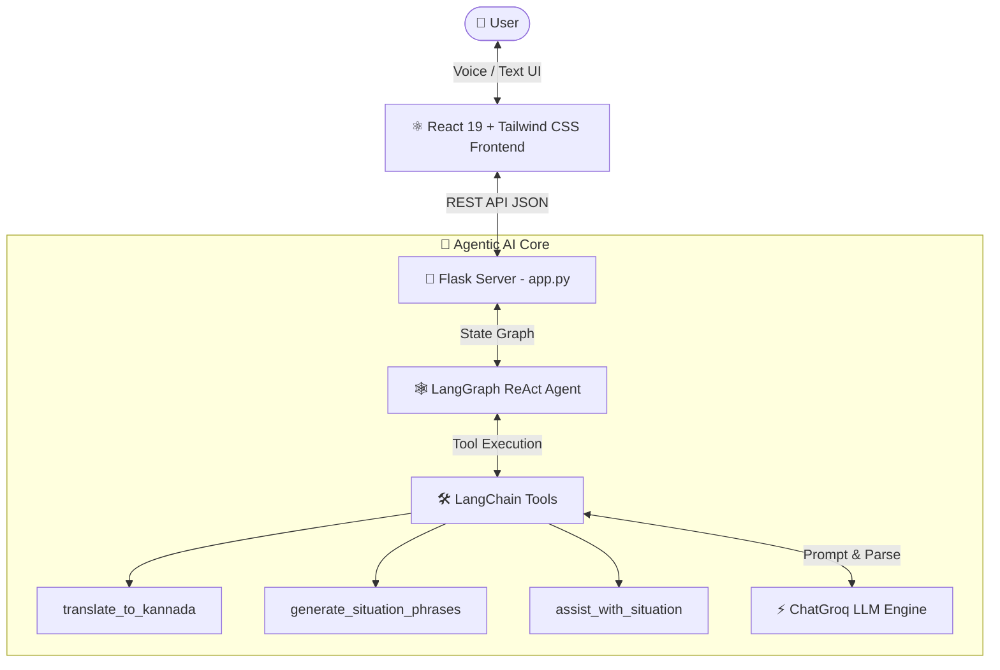

# 🌟 Kannada Saathi (ಕನ್ನಡ ಸಾಥಿ) - Kannada in Everyday Life

<div align="center">

[](https://react.dev/)
[](https://vitejs.dev/)
[](https://tailwindcss.com/)
[](https://www.python.org/)
[](https://flask.palletsprojects.com/)
[](https://www.langchain.com/)
[](https://langchain-ai.github.io/langgraph/)
[](https://groq.com/)

**An intelligent, AI-powered Kannada language companion designed for real-world daily life in Karnataka.**  
*Bridging communication gaps for commuters, students, travelers, and residents with speech recognition, dynamic agents, and voice playback.*

[Features](#-key-features) • [Architecture](#-system-architecture) • [Tech Stack](#-tech-stack) • [Quick Start](#-quick-start-guide) • [API Reference](#-api-endpoints) • [Contributing](#-contributing)

</div>

---

## 📖 Overview

Moving to or living in Karnataka (especially vibrant hubs like Bengaluru, Mysuru, or Mangaluru) often requires communicating in local Kannada for everyday needs—bargaining with auto drivers, ordering coffee at a Darshini, shopping at local markets, or seeking medical assistance.

**Kannada Saathi** is built to solve this practical challenge. Instead of dry textbook grammar or robotic literal translations, Kannada Saathi acts as your personal cultural and linguistic guide. It translates your intent into natural, colloquial Kannada that locals actually speak, complete with:
- ✍️ **Kannada Script** (ಕನ್ನಡ ಲಿಪಿ)
- 🔤 **English Transliteration / Pronunciation** (Namaskara, Hegiddira)
- 💡 **Meaning in English**
- 🔊 **Audio Pronunciation Playback**

---

## ✨ Key Features

### 1. 🌐 Everyday Translator (`01 / TRANSLATOR`)
- Translate conversational sentences from **Hindi** or **English** into practical spoken Kannada.
- Avoids awkward word-by-word literal translations in favor of natural phrasing.
- Clean structured output: Kannada script, pronunciation guide, and English meaning.

### 2. 🧭 Real-Life Situations (`02 / PHRASE FINDER`)
- Explore curated, goal-oriented phrases across four essential daily domains:
  - ✈️ **Travel & Commute**: Auto rickshaws, BMTC buses, Metro, stops, and fare inquiries.
  - 🛍️ **Shopping & Markets**: Asking prices, requesting discounts, sizing, and payment.
  - 🍽️ **Restaurants & Food**: Ordering local dishes, water, spice levels, and the bill.
  - 🩺 **Healthcare & Emergencies**: Pharmacy needs, doctor visits, and basic health symptoms.
- Phrases are dynamically generated via AI to fit user-specified context.

### 3. 💬 Ask Kannada Saathi (`03 / PERSONAL LANGUAGE HELP`)
- Simply describe any real-world dilemma (e.g., *"I want to tell the cab driver to take the flyover instead of the underpass"*).
- Saathi understands the social context and provides 1 to 3 realistic sentences you can speak immediately.

### 4. 🎙️ Interactive Voice Assistant (`SPEECH & AUDIO`)
- **Speech-to-Text**: Speak naturally in Hindi (`hi-IN`) or English (`en-IN`) using the browser's Web Speech API.
- **Agent Intelligence**: The spoken text is processed by a LangGraph ReAct agent that selects the optimal assistance tool.
- **Text-to-Speech (TTS)**: Listen to native Kannada audio playback with custom pronunciation speed.
- **One-Click Copy**: Copy any phrase or script to your clipboard instantly.

---

## 🏗️ System Architecture



---

## 💻 Tech Stack

### Frontend
- **Framework**: [React 19](https://react.dev/)
- **Bundler**: [Vite 8](https://vitejs.dev/)
- **Styling**: [Tailwind CSS v4](https://tailwindcss.com/)
- **Audio APIs**: Web Speech Recognition API & Web SpeechSynthesis API

### Backend
- **Framework**: [Flask 3](https://flask.palletsprojects.com/) + Flask-CORS
- **Agent Framework**: [LangChain](https://www.langchain.com/) & [LangGraph](https://langchain-ai.github.io/langgraph/)
- **LLM Provider**: [Groq Cloud](https://groq.com/) (Fast Inference Engine)
- **Environment Management**: Python-dotenv

---

## 📂 Project Structure

```bash
Kannada-in-Everyday-Life/
├── backend/
│   ├── .env.example        # Environment variable template for backend
│   ├── app.py              # Flask REST API endpoints & route handlers
│   ├── chain_demo.py       # LangChain prompt templates, tools & ChatGroq setup
│   ├── graph_demo.py       # LangGraph state graph and ReAct agent definition
│   └── requirements.txt    # Python backend dependencies
│
├── frontend/
│   ├── public/             # Static assets and icons
│   ├── src/
│   │   ├── assets/         # Project images and logos
│   │   ├── App.css         # Custom layout styling
│   │   ├── App.jsx         # Main application container & tabs
│   │   ├── index.css       # Global styles and Tailwind directives
│   │   ├── main.jsx        # React root entrypoint
│   │   └── VoiceAssistant.jsx # Voice recognition & Kannada TTS player
│   ├── .env.example        # Environment variable template for frontend
│   ├── eslint.config.js    # Linting rules
│   ├── index.html          # HTML5 entry page
│   ├── package.json        # Node dependencies & npm scripts
│   └── vite.config.js      # Vite build configuration
│
├── .gitignore              # Git ignore rules for secrets, venv & node_modules
└── README.md               # Project documentation
```

---

## 🚀 Quick Start Guide

### Prerequisites
- **Python**: `3.10` or higher
- **Node.js**: `18.x` or higher
- **Groq API Key**: Get a free API key from [Groq Console](https://console.groq.com/keys)

---

### 1️⃣ Backend Setup

1. **Navigate to the backend directory**:
   ```bash
   cd backend
   ```

2. **Create and activate a virtual environment**:
   - On Windows (PowerShell):
     ```powershell
     python -m venv venv
     .\venv\Scripts\Activate.ps1
     ```
   - On macOS / Linux:
     ```bash
     python3 -m venv venv
     source venv/bin/activate
     ```

3. **Install dependencies**:
   ```bash
   pip install -r requirements.txt
   ```

4. **Configure environment variables**:
   Create a `.env` file in the `backend/` folder (or copy from `.env.example`):
   ```bash
   cp .env.example .env
   ```
   Open `.env` and add your Groq API key:
   ```env
   GROQ_API_KEY=gsk_your_actual_groq_api_key_here
   ```

5. **Start the Flask server**:
   ```bash
   python app.py
   ```
   *The backend will run at `http://127.0.0.1:5000`.*

---

### 2️⃣ Frontend Setup

1. **Open a new terminal and navigate to the frontend directory**:
   ```bash
   cd frontend
   ```

2. **Install Node packages**:
   ```bash
   npm install
   ```

3. **(Optional) Configure environment variables**:
   Copy `.env.example` to `.env`:
   ```bash
   cp .env.example .env
   ```
   *(Default points to `http://127.0.0.1:5000`)*

4. **Start the development server**:
   ```bash
   npm run dev
   ```
   *Open `http://localhost:5173` in your browser (Google Chrome is recommended for microphone & voice synthesis support).*

---

## 📡 API Endpoints

| Method | Endpoint | Description | Payload Example |
| :--- | :--- | :--- | :--- |
| `GET` | `/` | Health check & service status | — |
| `POST` | `/translate` | Translates text to natural Kannada | `{"sentence": "Where can I find fresh vegetables?"}` |
| `GET` | `/situations` | Returns list of supported categories | — |
| `POST` | `/situations` | Generates phrases for selected scenario | `{"situation": "Shopping", "goal": "Ask for discount"}` |
| `POST` | `/ask` | Contextual Kannada advice for user scenario | `{"situation": "Auto driver asking extra fare"}` |
| `POST` | `/voice` | Voice-to-agent processing endpoint | `{"text": "Bhaiya mujhe railway station jana hai"}` |

---

## 🔒 Security & Best Practices

- 🛡️ **Zero Hardcoded Secrets**: All API keys and environment variables are strictly managed via `.env` files.
- 🚫 **Git Ignored**: `.env`, virtual environments (`venv/`), and `node_modules/` are explicitly excluded from version control.
- ⚙️ **Fallback Error Handling**: Both backend and frontend include friendly error fallbacks for network drops, missing keys, or unsupported browser APIs.

---

## 🤝 Contributing

Contributions, feedback, and feature suggestions are welcome!
1. Fork the repository
2. Create your feature branch (`git checkout -b feature/AmazingFeature`)
3. Commit your changes (`git commit -m 'Add some AmazingFeature'`)
4. Push to the branch (`git push origin feature/AmazingFeature`)
5. Open a Pull Request

---

## 📄 License

This project is open-source and available under the [MIT License](LICENSE).

<div align="center">
  <sub>Made with ❤️ for Kannada and Karnataka. ನಮಸ್ಕಾರ!</sub>
</div>
